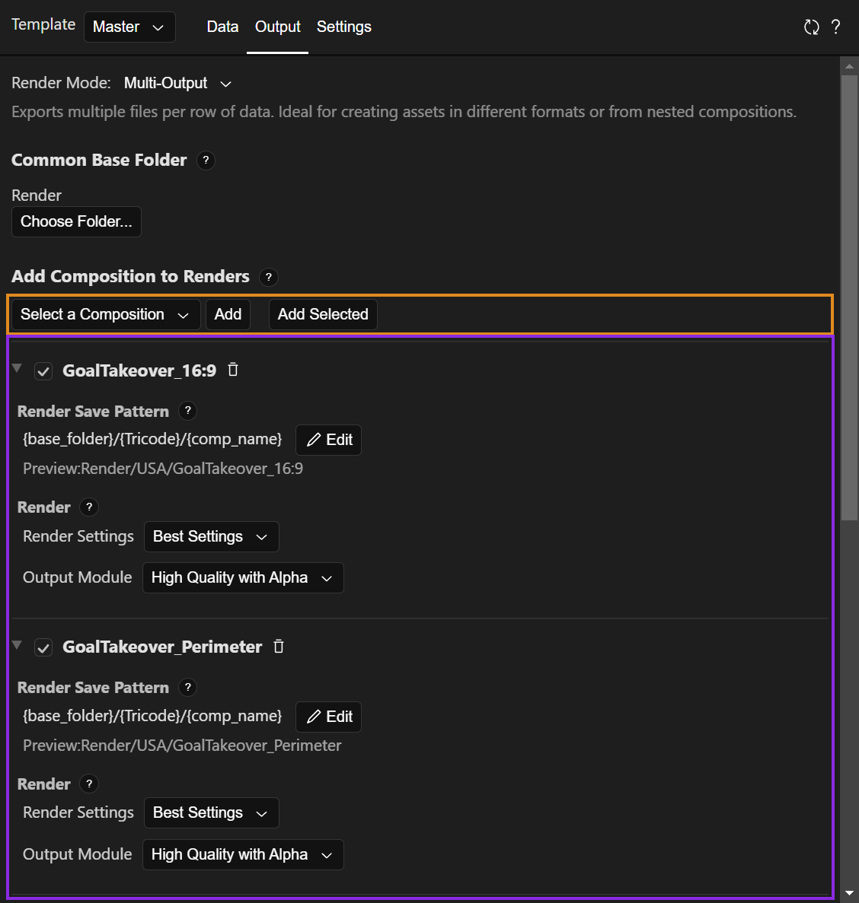

# Multi-Output Render

<iframe width="auto" style="aspect-ratio:1.77" src="https://www.youtube.com/embed/yUYWKYR3Zh0?si=amDsiVeSxAQdadN5" title="YouTube video player" frameborder="0" allow="accelerometer; autoplay; clipboard-write; encrypted-media; gyroscope; picture-in-picture; web-share" referrerpolicy="strict-origin-when-cross-origin" allowfullscreen></iframe>

Use `Multi-Output` when every row of data must produce **several renders**, each from a different composition. This page complements the video with details that are easy to miss. It assumes you have completed [Getting Started](getting-started.md). For every control of the `Output` tab, see [Output Tab](tab-output.md).

## How It Works

| | One Per Row | Multi-Output |
| --- | --- | --- |
| Renders | The template, once per row | Any compositions you choose, for every row |
| Row values are applied to | A temporary layer of the template, through its Essential Graphics properties | **The original properties** in the template (master) composition |
| Render settings | One configuration | One per composition |

Since the values are written to the master composition, every composition **linked to those properties** (with the pick whip or your own expressions) follows along. One Essential Graphics setup can drive many compositions.

!!! warning "The master composition is modified"
    While the batch runs, EasyBatch changes the values of the master composition, and replaces the source of its replaceable layers. When it finishes, the master keeps the values of the last row. Save your project before starting a large batch, and do not edit it while it runs.

## Setting Up the Template

- Only the properties exposed in the master composition are data. Everything linked to them updates automatically, so the other compositions do not need their own Essential Graphics setup.
- Essential Graphics can expose any layer that is **nested inside the master composition**. In the tutorial, the flag lives in the render compositions, which are layers of the master, so it can be dragged into the panel from there.
- Use `View` > `Edit View...` to reorder or hide columns while you work. It only changes what is displayed.

## Loading Replaceable Files with a Pattern

A replaceable column (the flag) needs a file for every row. Without one, the row reports `No file path provided for '…'`. Click the column's pattern button (see [Data Tab](tab-data.md#patterns)) and build a pattern such as:

```text
{base_folder}/flag_{Tricode}.jpg
```

- The pattern is resolved for each row with that row's values. The preview shows the first row, with a green check if the file exists and a yellow warning if it does not.
- Folders are stored **relative to the project**, so save the project first. This keeps the project portable on shared drives.
- Files are imported when needed, and placed in the project folder set in `Settings` > `Imported Footage Folder` (`~Imported by EasyBatch` by default). Files already in the project are reused.
- A file chosen manually for a row (shown in bold) is not overwritten by the pattern.

## Importing Excel Data

Open `File` > `Import Excel Data`. Besides what the video shows:

- Supported files are `.xlsx`, `.xls`, and `.xlsm`. Save the After Effects project first, because the file's location is stored relative to it.
- The first row of the sheet holds the column names. Names are matched to template properties exactly, then ignoring case, then ignoring spaces, underscores, hyphens, and periods. Fix any mismatch with the dropdown, or choose `Do not import` to keep a property as it is.
- The table gets one row for each data row of the sheet. Unmapped properties keep their values, and the last value is repeated if there are more rows.
- Colors can be hex codes, such as `#1E90FF`.
- After the first import, the `File` menu lists the file with two actions: `Re-import` reloads it with the saved sheet and mapping, and `Save Updates` writes the values from EasyBatch back to the mapped columns without overwriting cells that contain formulas.

CSV files work as well. See [Importing CSV Data](tab-data.md#importing-csv-data).

## Configuring the Output

{ width="500" }

- **Common Base Folder:** The folder all renders share. It is relative to the project.
- **Adding compositions:** Use the dropdown (searchable) and `Add`, or select compositions in the Project panel and `Add Selected`. You can add **any composition in the project**, even if it is not related to the template.
- **Per composition:** A checkbox to skip it without removing it, a trash icon to remove it, its own save pattern, and its own Render Settings and Output Module.

!!! tip "Configure the first composition carefully"
    A new composition starts with a copy of the **last** one's settings, including its pattern and templates. If the pattern uses `{comp_name}`, it works for every composition you add afterward. Only the very first one starts with After Effects' default templates.

### Save Pattern

Click `Edit` to change it. The default is `Renders/{comp_name}_{row_number}`. The fields are `{base_folder}`, `{template_name}`, `{comp_name}`, `{row_number}`, `{increment:0000}`, and every property of your template. For example, to create one folder per country:

```text
{base_folder}/{Tricode}/{comp_name}
```

- Use `/` for folders on Windows and Mac. Folders are created automatically.
- Do not type an extension. The Output Module provides it.
- `< > " | ? *` are removed from paths.
- `{row_number}` starts at 0.

### Single Frame PNG

In the Output Module dropdown, `Single Frame PNG` saves the frame at time 0 straight to a `.png` file, without a frame number in the name. These compositions are not queued, so After Effects may look idle while they export. See [Output Tab](tab-output.md#output-module-single-frame-as-png).

## During the Render

Click `Batch One to Many`. For every row, EasyBatch:

1. Writes the row's values into the master composition (values that already match are skipped).
2. Queues each enabled composition with its own pattern and templates.
3. Deletes files that already exist at those paths, so previous renders are replaced.
4. Renders the queue, then moves to the next row.

The render queue is cleared when the batch starts, so queued items you had before are removed. The batch blocks the After Effects interface, and **`Esc` cancels** the remaining renders (see [Known Issues](known-issues.md)).

To render only one row, select it and press `r` (or `Edit` > `Render Row`). The row is then treated as row 0 for `{row_number}` and `{increment}`, so name the files with template properties instead.

### Results and Duplicate Paths

The `Output` tab lists every composition rendered for every row (row numbers start at 0):

- **Green check:** Queued successfully.
- **Yellow warning:** Queued, but a property could not be applied, for example a missing replaceable file. **The composition keeps what it had before, which is the previous row's image.** Also shown when the batch was stopped.
- **Red cross:** The row failed.

Before rendering, each composition's paths are checked across rows. If two rows resolve to the same path, the batch does not start and the conflicts are listed. Compositions are **not** compared with each other, so use `{comp_name}` or different folders to keep their files apart.

## Troubleshooting

- **A composition does not follow the data:** Check that its property is linked to a property exposed in the master composition.
- **Warning on a file:** The pattern points to a file that does not exist. Check the name, extension, and the column used in the pattern.
- **Duplicate output paths:** Use a property that is different for each row in the pattern.
- **Cannot pick a folder or import Excel:** Save the project first.
