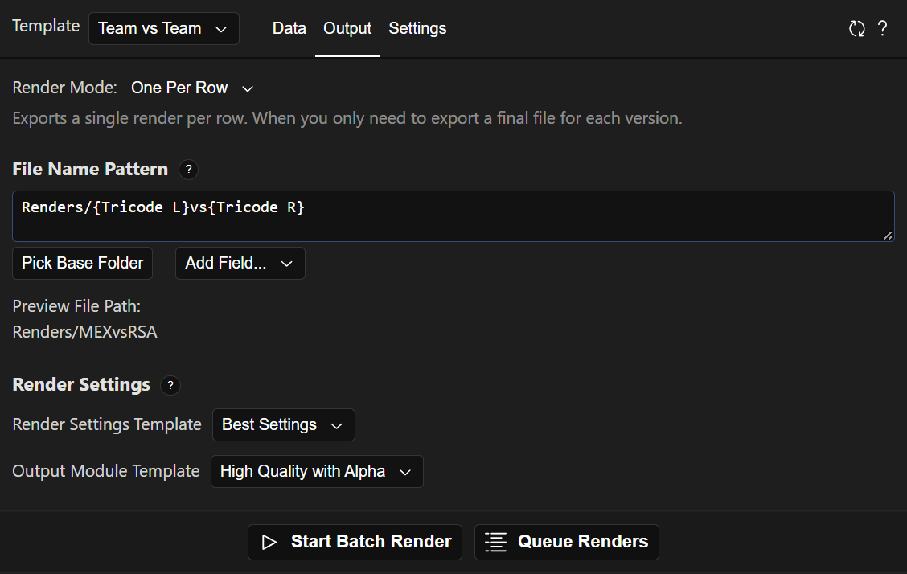
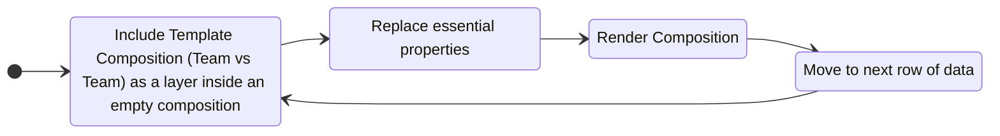
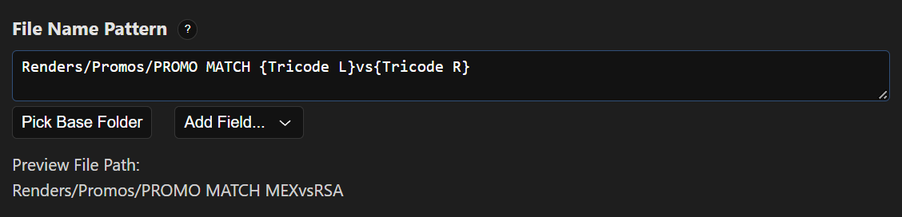
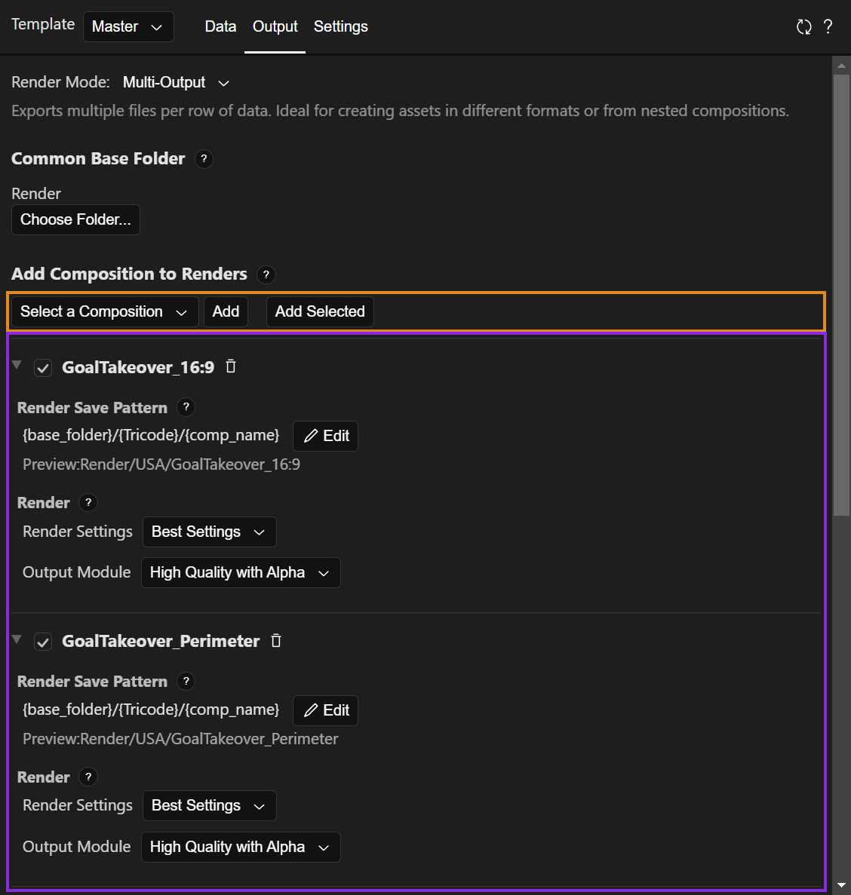

The `Output` tab is where you configure how your renders are generated and where they are saved. You can choose between rendering files and generating compositions, define dynamic file name patterns, and select the render settings and output module for the generated files.

## Render Modes
Render modes define what the extension does with each row.

## Render Mode: One Per Row
This is the simplest mode. Each row is applied to the template and then exported in the format you define below.

Internally, EasyBatch performs these actions:

### File Name Pattern
This feature allows you to give your renders dynamic names and paths. The pattern is interpreted for each render to generate the final file path.

In the screenshot above, the pattern `{base_path}/PROMO MATCH {Tricode L}vs{Tricode R}` will be replaced as `Renders/Promos/PROMO MATCH MEXvsRSA`.

If you include `/` in the pattern, it is interpreted as a subfolder. The pattern can therefore create subfolders dynamically.

The pattern is made up of fields. In the example above, `{base_path}`, `{Tricode L}`, and `{Tricode R}` are fields. The available fields are:

- **Base Folder**:
A `Base Folder` allows you to select a folder instead of typing its path into the pattern. Typically, this is the folder that all your renders have in common. If you select a folder on the same drive as the project, the path will be relative and will not include the drive letter. This helps keep the project portable.

    To select a base path, click the `Pick Base Folder` button. To add it to the pattern, click `Add Field` and select `Base Path`. This is equivalent to typing `{base_path}` in the pattern.

    In the screenshot above, we selected the folder `Renders/Promos`, where `Renders` is located in the same folder as the project. Because the path is relative to the project location, it is saved as `Renders/`.

- **Template Name**:
Replaces `{template_name}` with the name of the template (surprise!). In this case, it produces `Team vs Team`.

- **Row Number**:
Replaces `{row_number}` with the current row index. If you have 20 renders, the first one is `0` and the last one is `19`.

- **Increment**:
A configurable increment. `{increment:0001}` produces `0001` for the first row and `0002` for the second row. `{increment:050}` produces `050` for the first row and `051` for the second row.

- **Custom**:
You can also add the value of any template property to the pattern. In the screenshot above, `{Tricode L}` is replaced with the value in the `Tricode L` column for the current row. For every subsequent row and render, this value is updated to match that row.

!!! note "Backslashes in Windows"
    In both Windows and macOS, use forward slashes to separate directories.

### Render Settings

To define the render configuration for all files generated from this template, select a preset for both Render Settings and the Output Module.

- **Render Settings:** Equivalent to selecting a render settings template in the Render Queue. It affects quality, resolution, proxy settings, and more.
- **Output Module:** Equivalent to selecting an output module in the Render Queue. It affects the codec, compression, audio, and more.

To edit these templates, click `Edit` > `Templates` in the After Effects menu bar, then select the templates you want to modify.

### Render
When you are ready, click `Start Batch Render`.

## Render Mode: Multi Output
Use **Multi-Output** to export several versions from each row, such as a full-screen graphic and a scorebug. If both compositions are linked to your main template, they can use the same row of data. This mode changes the values in your original template composition.

{width="500"}

### Render Compositions (Purple)
These are the compositions that the extension renders in this mode. You can add any composition in the project, including the Template Composition.

To add a composition, click the dropdown (orange) below `Compositions to Renders`, then select a composition. You can type to search. After selecting a composition, click `Add`. Alternatively, select one or more compositions in the Project panel, then click `Add Selected` and they will be added to the list of compositions to be rendered.

#### Disable Render
At some point, you may not need to render all the compositions you added. Use the checkboxes to prevent them from rendering.

#### Delete Comp
Click on the trash icon to remove the composition from the list.

#### Pattern
Each composition uses a pattern as well. This pattern works the same way as the pattern in `One Per Row` mode. The main difference is that all render compositions share the same base folder for convenience.

In the example pictured, the compositions have the same pattern. This works because the pattern uses the composition name and the country code to save each file, so every file has a unique name.

!!! tip "Pro Tip"
    Whenever you add a composition to the renders, its configuration is copied from the previous composition, including the pattern. If you have several compositions that use the same pattern, setting up the first one carefully can save time.

Each Render Composition will have a pattern preview.

#### Render Settings

The render settings work the same way as in `One Per Row` mode. Each export can have a different configuration.

##### Output Module: Single Frame as PNG
This is a special mode provided by the extension that lets you save the composition as a single-frame PNG. Compared with using a preset, the main advantage is that this mode does not attach sequence numbers to the exported file, which is otherwise unavoidable.

Single-frame PNGs don't appear in the After Effects Render Queue. Check **Results** in EasyBatch to see when they're ready.

!!! warning "32 bit projects"
    This mode may not work properly in 32-bit projects.

### Render
Check the rows you want to export, then click **Start Batch Render**. While the batch is running, only the **Output** tab is available. The progress bar shows how many exports have finished, and **Results** shows the status of each export.

If another render is running or paused in the After Effects Render Queue, finish or stop it there before starting a new batch.

In **Results**, click a row to see its compositions, export statuses, and file paths. Use **Collapse All** to close every open row. A row is **Completed** only when all its exports finish. A clock marks a pending export. Hover over a shortened path to see it in full, or click **Open Containing Folder** to find it in Finder or File Explorer.

- **Pause Now** pauses the current render. **Continue** picks up where it left off.
- **Stop Batch** cancels the current render, even when paused, and clears the After Effects Render Queue and the batch's progress. Files that already finished are kept. Click **Start Batch Render** to render from the first checked row again.
- If an export fails, EasyBatch asks whether to continue or stop. Files that already finished are kept.

If you reopen the panel with an unfinished batch, select the same template and click **Continue**. If you've added or removed rows and **Continue** is no longer available, click **Stop Batch**, check the rows you want, and start a new batch.
    
## Render Mode: Generate Comps
This mode generates one composition per row and replaces its properties with the corresponding row data. Use it when you need to modify the resulting compositions without access to EasyBatch.